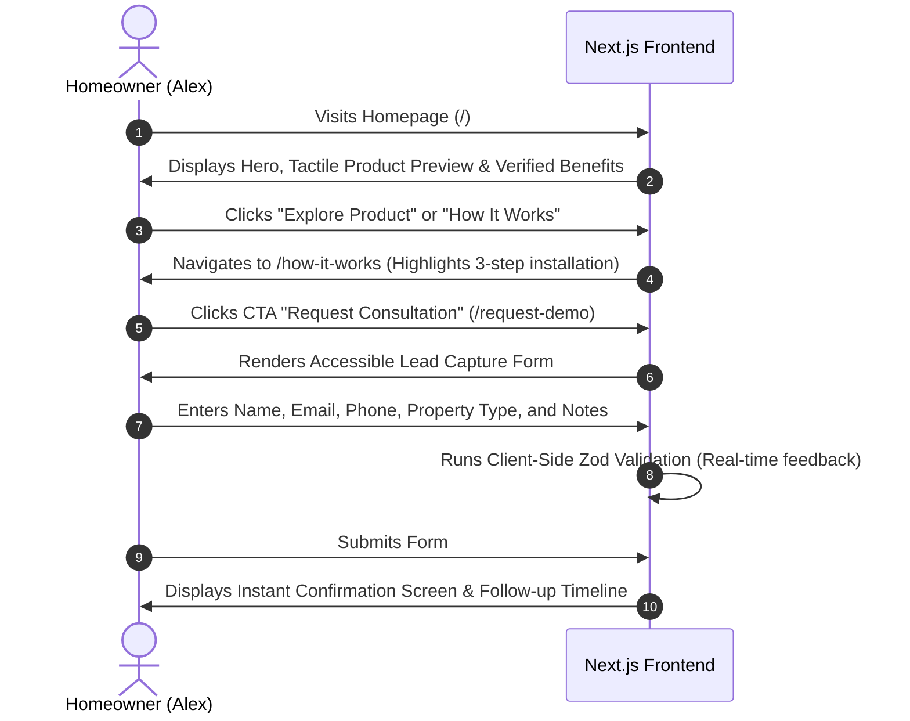
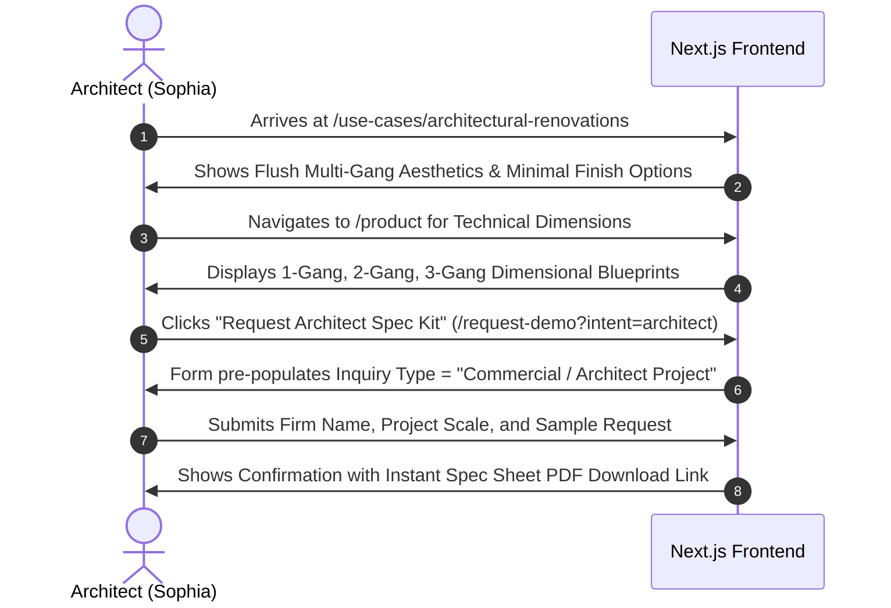
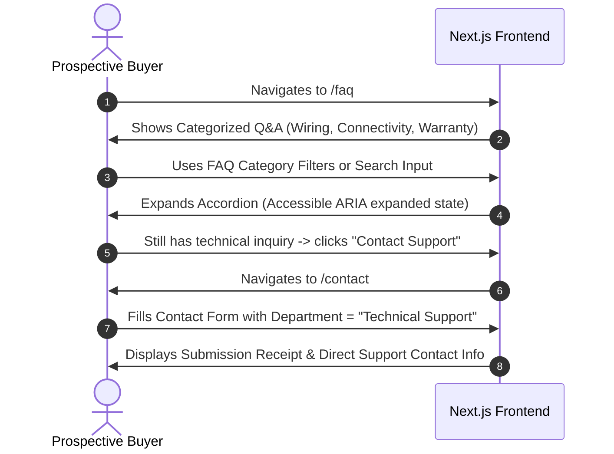

# Smart Switch — User Flows & Conversion Journeys

## 1. Primary Persona Profiles

1. **The Modern Homeowner (Alex)**:
   - *Goal*: Seeking premium, reliable electrical switches that look sophisticated on the wall, operate silently, and work physically even if Wi-Fi drops.
   - *Concerns*: Wiring compatibility, neutral wire requirements, ease of certified installation.
2. **The Architect / Interior Designer (Sophia)**:
   - *Goal*: Specifying minimal, high-end switch plates that complement luxury interiors across residential or boutique commercial projects.
   - *Concerns*: Finish options (matte black, brushed aluminum, minimal white), multi-gang flush mounting, technical spec sheets.
3. **The Certified Electrician (Marcus)**:
   - *Goal*: Recommending reliable, safe hardware that complies with electrical code, doesn't cause nuisance callbacks, and offers partner pricing.
   - *Concerns*: Terminal wiring space, voltage/wattage ratings, certified safety standards.

---

## 2. Journey 1: Homeowner Consultation & Quote Flow

---

## 3. Journey 2: Architect Spec Sheet & Sample Kit Request

---

## 4. Journey 3: General Customer Support / FAQ Discovery

